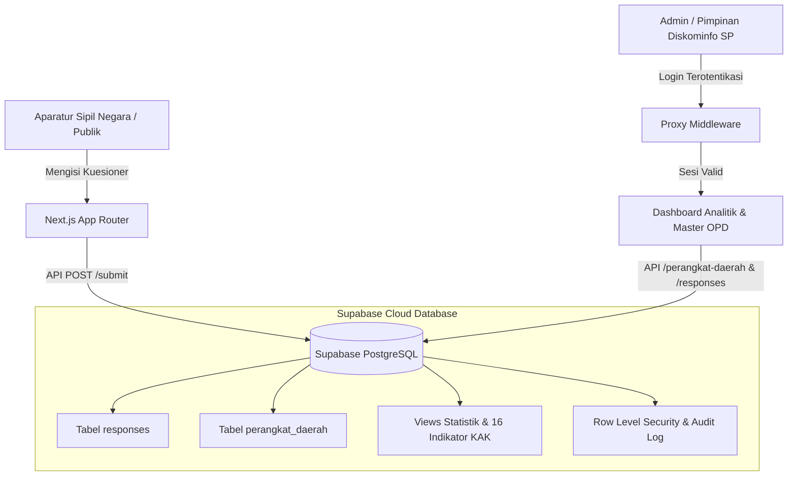

<div align="center">

# 🏛️ Survei Pemanfaatan AI — Pemkab Hulu Sungai Tengah 2026

**Aplikasi Kuesioner Digital, Analitik Statistik Sektoral & Dashboard Eksekutif Berbasis 16 Indikator KAK Resmi**  
*Diskominfo SP Kabupaten Hulu Sungai Tengah · Provinsi Kalimantan Selatan*

[](https://nextjs.org/)
[](https://react.dev/)
[](https://supabase.com/)
[](https://www.postgresql.org/)
[](https://vercel.com/)
[](LICENSE)
[](https://hulusungaitengahkab.go.id/)

<p align="center">
  <a href="#-tentang-proyek">Tentang</a> •
  <a href="#-fitur-utama">Fitur Utama</a> •
  <a href="#-arsitektur--teknologi">Teknologi</a> •
  <a href="#-16-indikator-resmi-kak">Indikator KAK</a> •
  <a href="#-instalasi--penggunaan">Panduan Instalasi</a> •
  <a href="#-deployment-ke-vercel">Deployment</a>
</p>

---

</div>

## 📌 Tentang Proyek

Aplikasi **Survei Pemanfaatan Artificial Intelligence (AI) Tahun 2026** dirancang dan dibangun khusus untuk Pemerintah Kabupaten Hulu Sungai Tengah guna memetakan kesiapan, tingkat literasi, pola pemanfaatan, serta risiko keamanan data dinas di lingkungan Aparatur Sipil Negara (ASN) dan Non-ASN.

Sistem ini menerjemahkan secara presisi seluruh butir instrumen dan ketentuan dalam **Kerangka Acuan Kerja (KAK) Resmi Survei AI 2026**, menghasilkan analitik statistik sektoral real-time untuk perumusan kebijakan, penyusunan pedoman resmi bupati, dan rencana bimbingan teknis (Bimtek) AI.

---

## ✨ Fitur Utama

### 1. 📋 Portal Kuesioner Digital Publik (`/survei`)
- **Struktur 7 Seksi KAK Lengkap**: Menghimpun Seksi Persetujuan (PS), Seksi A (Identitas Responden), Seksi B (Literasi & Sikap), Seksi C (Pemanfaatan), Seksi D (Keamanan Informasi & PDP), Seksi E (Kesiapan Infrastruktur & Data), serta Seksi F (Hambatan & Harapan).
- **Logika Adaptif (Skip Logic)**: Responden yang belum pernah memakai AI dilewatkan dari pertanyaan operasional mendalam dan langsung diarahkan ke identifikasi hambatan (Seksi C7).
- **Proteksi Pengisian Ganda**: Identifikasi berbasis *fingerprint pseudo-anonymous* per perangkat untuk menjaga validitas data (1 aparatur = 1 kali pengisian).
- **Simpan Otomatis (Auto-Save & Resume)**: Jawaban tersimpan di peramban lokal sehingga tidak hilang apabila koneksi internet terputus di tengah jalan.
- **Kerahasiaan Mutlak**: Tidak menghimpun NIP, Nama, NIK, No. HP, maupun alamat IP demi kepatuhan prinsip perlindungan data pribadi (PDP).

### 2. 📊 Dashboard Analitik Eksekutif Satu Layar (`/dashboard`)
- **Navigasi Sidebar Terstruktur**: Akses cepat ke seluruh modul pemantauan tanpa scroll berlebih dengan sistem *paginated pane*:
  - **Resume Eksekutif**: Ringkasan KPI makro, skor komposit ILA & IKID, target capaian, dan *radar alerts*.
  - **Literasi & Sikap ASN**: Pengukuran Indeks Literasi AI (ILA), Indeks Sikap (IS), serta pemetaan tingkat pengetahuan faktual.
  - **Pemanfaatan & Profil Alat**: Proporsi pengguna rutin, sebaran aplikasi dominan (ChatGPT, Gemini, Copilot, Canva, dll.), serta kasus penggunaan dinas.
  - **Keamanan & Risiko Informasi**: Deteksi dini kebocoran data sensitif (I-09), kepatuhan verifikasi hasil AI (I-10), dan matriks persepsi risiko dinas.
  - **Kesiapan & Hambatan**: Kualitas jaringan internet kantor, ketersediaan perangkat PC/laptop dinas, dan kebutuhan pelatihan kepegawaian.
  - **16 Indikator Resmi KAK**: Scorecard interaktif Tabel 10 KAK dengan visualisasi persentase dan navigasi halaman.
  - **Data Mikro Responden**: Tabel data mentah ber-paging dengan filter anomali dan fitur pembersihan.
  - **Master Perangkat Daerah**: Modul manajemen instansi terpadu.

### 3. 🏢 Master Perangkat Daerah (39 Instansi Resmi)
- Memuat seluruh 39 Perangkat Daerah Kabupaten Hulu Sungai Tengah (Sekretariat Daerah, Sekretariat DPRD, Inspektorat, 5 Badan, 15 Dinas, Satpol PP, 11 Kecamatan, dan 4 Bagian Setda).
- Filter menurut kelompok instansi (*Dinas, Badan, Kecamatan, Sekretariat/Bagian*).
- Fitur CRUD lengkap (Tambah OPD, Edit Nama/Kode/Urutan, serta Toggle Status Aktif/Nonaktif).

### 4. 🧹 Pembersihan & Validasi Kualitas Data
- **Deteksi Cepat (< 2 Menit)**: Menandai responden yang mengisi terlalu cepat di bawah batas ambang kewajaran KAK N.1.
- **Deteksi Jawaban Seragam**: Mendeteksi pola *straight-lining* pada skala Likert.
- **Fitur Hapus Data Tidak Relevan**: Admin dapat menghapus data responden yang tidak valid atau data uji coba langsung dari tabel dengan rekalkulasi statistik instan.
- **Pembersihan Massal**: Satu klik untuk membersihkan semua data anomali sebelum laporan final diekspor.

### 5. 🛡️ Keamanan & Akses Terproteksi
- **Wajib Login Supabase Auth**: Akses dashboard internal diproteksi oleh *Proxy Middleware* Next.js dan validasi server-side.
- **Database Row Level Security (RLS)**: Hak akses tabel diatur ketat di PostgreSQL Supabase (publik hanya memiliki hak `INSERT`, sedangkan `SELECT` dan `DELETE` hanya terbuka untuk admin terautentikasi).

---

## 🛠️ Arsitektur & Teknologi



| Layer | Komponen / Teknologi | Keterangan |
| :--- | :--- | :--- |
| **Framework** | **Next.js 16.4.2** (Turbopack + App Router) | Rendering performa tinggi, Server Components, dan dynamic proxy |
| **User Interface** | **React 19** + **Vanilla CSS Modular** | Desain bertema *Cyber-Slate Glassmorphism*, responsif, tanpa dependensi framework CSS eksternal |
| **Database** | **Supabase (PostgreSQL 15+)** | Database relasional dengan RLS, Stored Procedures, Views, dan Audit Trail |
| **Autentikasi** | **Supabase Auth** (`@supabase/ssr`) | Otentikasi sesi berbasis cookie terenkripsi untuk pengelola dinas |
| **Export Engine** | Custom In-Memory Generator | Ekspor dataset ke format CSV dan TSV kompatibel Excel/SPSS |
| **Hosting Target**| **Vercel Cloud Platform** | Serverless Edge Deployment dengan SSL dan CDN global otomatis |

---

## 📊 16 Indikator Resmi KAK

Aplikasi menghitung dan memvisualisasikan seluruh 16 indikator resmi sesuai dokumen KAK Tabel 10:

| Kode | Nama Indikator | Definisi Operasional | Target / Acuan |
| :---: | :--- | :--- | :---: |
| **I-01** | Proporsi Pengguna AI | Responden C1 ≠ "Belum pernah" / Total × 100% | baseline |
| **I-02** | Proporsi Pengguna Rutin | Responden C1 "Harian" atau "Mingguan" / Total × 100% | baseline |
| **I-03** | Sebaran Aplikasi AI | Persentase penggunaan ChatGPT, Gemini, Copilot, Canva, dll. | sebaran |
| **I-04** | Sebaran Kasus Penggunaan | % ASN memanfaatkan AI untuk naskah dinas, riset, paparan, coding | sebaran |
| **I-05** | Proporsi Akun Berbayar | Responden C3 yang memakai akun berbayar mandiri atau dinas | &lt; 15% |
| **I-06** | Indeks Pengetahuan AI (IP) | Nilai rata-rata tes pemahaman faktual AI (Seksi B2) skala 0–100 | &gt; 65 |
| **I-07** | Indeks Sikap terhadap AI (IS) | Sikap positif & kehati-hatian ASN (Seksi B3) skala 0–100 | &gt; 70 |
| **I-08** | **Indeks Literasi AI (ILA)** | **Skor Komposit: (IP + IS + PD) / 3 skala 0–100** | **&gt; 65** |
| **I-09** | **Risiko Data Sensitif** | **% ASN pernah memasukkan data rahasia/pribadi warga (D1)** | **&lt; 10% (Kritis)** |
| **I-10** | Kepatuhan Verifikasi | % ASN yang selalu/sering memeriksa kebenaran hasil AI (D2) | &gt; 80% |
| **I-11** | Kesadaran Pedoman Pemda | % ASN yang mengetahui adanya pedoman/edaran AI Pemkab (E4) | monitoring |
| **I-12** | Tingkat Keikutsertaan Pelatihan | % ASN yang pernah mengikuti pelatihan/bimtek AI resmi (E5) | gap analisis |
| **I-13** | **Indeks Kesiapan (IKID)** | **Kesiapan konektivitas internet, PC dinas, & tata kelola data** | **&gt; 60** |
| **I-14** | Hambatan Utama Adopsi | Ranking hambatan terbesar yang dihadapi ASN di lapangan (F1) | prioritas |
| **I-15** | Persepsi Risiko Terbesar | Kekhawatiran kebocoran data, halusinasi informasi, dan plagiasi (F2)| mitigasi |
| **I-16** | Kesediaan Mengikuti Bimtek | % ASN yang bersedia mengikuti pelatihan AI lanjutan (F3) | &gt; 75% |

---

## 🚀 Instalasi & Penggunaan

### 1. Kloning Repository
```bash
git clone https://github.com/hakiem17/surveiaihst.git
cd surveiaihst
```

### 2. Pasang Dependensi
```bash
npm install
```

### 3. Konfigurasi Variabel Lingkungan
Salin file `.env.example` menjadi `.env.local`:
```bash
cp .env.example .env.local
```

Lalu sesuaikan nilai kredensial Supabase Anda di `.env.local`:
```env
NEXT_PUBLIC_SUPABASE_URL=https://xxxxxxxxxxxx.supabase.co
NEXT_PUBLIC_SUPABASE_ANON_KEY=sb_publishable_xxxxxxxxxxxxxxxx
NEXT_PUBLIC_SUPABASE_PUBLISHABLE_KEY=sb_publishable_xxxxxxxxxxxxxxxx

# Opsional untuk bypass RLS di server:
# SUPABASE_SERVICE_ROLE_KEY=eyxxxxxxxxxxxxxxxxxxxxxxxx
```

### 4. Setup Database Supabase
Jalankan skrip SQL di **Supabase Dashboard → SQL Editor** secara berurutan:
1. `supabase/schema.sql` (Struktur tabel, RLS, functions, dan views).
2. `supabase/seed_perangkat_daerah.sql` (Master data 39 Perangkat Daerah Pemkab HST).
3. `supabase/fix_permissions.sql` (Izin akses tabel untuk peran anon dan authenticated).
4. `supabase/seed_admin_example.sql` (Opsional: mendaftarkan akun admin pertama).

### 5. Jalankan Server Pengembangan
```bash
npm run dev
```
Buka [http://localhost:3000](http://localhost:3000) pada peramban Anda.

---

## 🌐 Deployment ke Vercel

Aplikasi ini telah dioptimalkan untuk hosting di Vercel:

1. **Import Proyek**: Masuk ke [Vercel](https://vercel.com) → **Add New Project** → pilih repository `surveiaihst`.
2. **Atur Environment Variables**: Masukkan 3 kunci environment pada menu konfigurasi Vercel:
   - `NEXT_PUBLIC_SUPABASE_URL`
   - `NEXT_PUBLIC_SUPABASE_ANON_KEY`
   - `NEXT_PUBLIC_SUPABASE_PUBLISHABLE_KEY`
3. **Deploy**: Klik tombol **Deploy**. Vercel akan otomatis melakukan build dan aplikasi langsung dapat diakses secara publik.

---

## 📁 Struktur Direktori

```
surveiaihst/
├── docs/                     # Dokumen referensi KAK & Kuesioner resmi
├── public/                   # Asset ikon, logo, dan SVG
├── src/
│   ├── app/
│   │   ├── api/
│   │   │   ├── auth/logout/  # Endpoint logout sesi
│   │   │   ├── export/       # Endpoint ekspor CSV/TSV
│   │   │   ├── perangkat-daerah/ # CRUD API 39 OPD
│   │   │   ├── responses/    # API hapus/kelola data responden
│   │   │   └── submit/       # Endpoint submit kuesioner dengan validasi KAK
│   │   ├── dashboard/        # Halaman dashboard analitik eksekutif
│   │   ├── login/            # Halaman login portal internal
│   │   ├── survei/           # Antarmuka kuesioner 7 seksi untuk ASN
│   │   ├── globals.css       # Token tema, CSS variables, & typography
│   │   ├── layout.js         # Root layout aplikasi
│   │   └── page.js           # Beranda landing page publik
│   ├── components/           # Komponen UI (Logo, badges, dll.)
│   ├── lib/                  # Logika bisnis, kalkulator skor ILA/IKID, master data, Supabase client
│   └── proxy.js              # Middleware proteksi rute dashboard
└── supabase/                 # Skrip SQL DDL schema, views, seed, & permissions
```

---

<div align="center">

**Pemerintah Kabupaten Hulu Sungai Tengah**  
*Mewujudkan Tata Kelola Pemerintahan yang Adaptif, Inovatif, dan Beretika di Era Kecerdasan Artifisial.*

</div>
